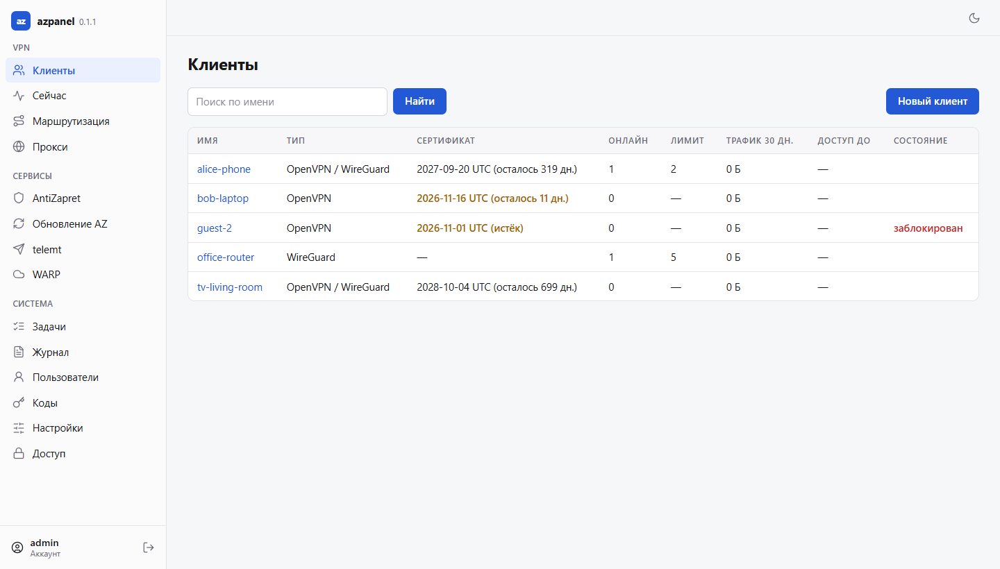

<h1 align="center">azpanel</h1>

<p align="center">Веб-панель для <a href="https://github.com/GubernievS/AntiZapret-VPN">AntiZapret-VPN</a>: клиенты OpenVPN и WireGuard, сроки и лимиты, мониторинг, маршрутизация, telemt, WARP и прокси в одном окне.</p>

<p align="center">
  <a href="https://github.com/syava842/azpanel/releases/latest"></a>
  <a href="https://github.com/syava842/azpanel/releases"></a>
  
</p>

<p align="center">
  <a href="#установка">Установка</a> ·
  <a href="#обновление">Обновление</a> ·
  <a href="#удаление">Удаление</a> ·
  <a href="#пароль-и-пользователи">Пароль и пользователи</a> ·
  <a href="docs/interface.md">Веб-интерфейс</a> ·
  <a href="docs/install.md">Подробно об установке</a>
</p>

---

azpanel ставится рядом с AntiZapret-VPN и управляет им через его же скрипты
(`client.sh`, `doall.sh`, `setup.sh`), не меняя их поведения. Это один файл
без зависимостей: Python, Node.js и отдельная база данных не нужны.
Интерфейс работает без интернета, в светлой и тёмной теме, на компьютере и
телефоне. Что делает каждая страница — в [описании интерфейса](docs/interface.md).

<picture>
  <source media="(prefers-color-scheme: dark)" srcset="docs/img/clients-dark.png">
  
</picture>

### По мотивам

| Проект | Что взято |
| --- | --- |
| [GubernievS/AntiZapret-VPN](https://github.com/GubernievS/AntiZapret-VPN) | основа: панель работает поверх его скриптов |
| [TheMurmabis/StatusOpenVPN](https://github.com/TheMurmabis/StatusOpenVPN) | мониторинг подключений и трафика, установка одной командой |
| [Kirito0098/AdminPanelAZ](https://github.com/Kirito0098/AdminPanelAZ) | управление клиентами и маршрутизацией из веб-интерфейса |
| [0009609ilya-crypto/vpn-control-panel](https://github.com/0009609ilya-crypto/vpn-control-panel) | панель управления VPN-сервером |
| [Liafanx/AZ-WARP](https://github.com/Liafanx/AZ-WARP) | управление WARP для AntiZapret |
| [telemt/telemt](https://github.com/telemt/telemt) | управление MTProto-прокси для Telegram |

## Установка

Нужны Ubuntu 24.04+ или Debian 13+ (amd64 или arm64) и права root. Если
AntiZapret-VPN ещё не установлен, скрипт предложит поставить.

```bash
bash -c "$(curl -fsSL https://raw.githubusercontent.com/syava842/azpanel/main/scripts/setup.sh)"
```

Скрипт проверяет подпись релиза и запускает мастер. Мастер спрашивает, как
открыть панель (путь `/azpanel/` в nginx, отдельный порт HTTPS или только
127.0.0.1), домен, HTTPS и логин администратора; перед изменениями показывает
итог и ждёт подтверждения. После установки панель доступна, например, по
адресу `https://<домен>/azpanel/`. Проверка: `azpanel doctor`.

Вопросы мастера, установка без вопросов, HTTPS и FAQ — в
[подробной инструкции](docs/install.md).

## Обновление

```bash
bash -c "$(curl -fsSL https://raw.githubusercontent.com/syava842/azpanel/main/scripts/update.sh)"
```

С проверкой подписи, бэкапом и откатом при сбое. На сервере то же:
`azpanel update`.

## Удаление

```bash
bash -c "$(curl -fsSL https://raw.githubusercontent.com/syava842/azpanel/main/scripts/uninstall.sh)"
```

Перед удалением делается бэкап AntiZapret; AntiZapret и клиенты остаются.
Настройки остаются в `/opt/azpanel`, `-- --purge` удаляет и их.

## Пароль и пользователи

Сменить или задать пароль, если он забыт:

```bash
bash -c "$(curl -fsSL https://raw.githubusercontent.com/syava842/azpanel/main/scripts/change_passwd.sh)" -- <логин>
```

Команды на сервере:

| Команда | Что делает |
| --- | --- |
| `azpanel user list` | список пользователей |
| `azpanel user add <логин>` | добавить пользователя (видит только своих клиентов) |
| `azpanel user add <логин> --admin` | добавить администратора |
| `azpanel panel passwd --user <логин>` | задать пароль (спросит дважды) |
| `azpanel user reset <логин>` | случайный пароль, 2FA выключить, сессии завершить |

`user add` и `user reset` показывают пароль один раз; при первом входе панель
попросит его сменить. В панели то же — **Пользователи → Новый пользователь**,
свой пароль — **Аккаунт → Пароль**.
