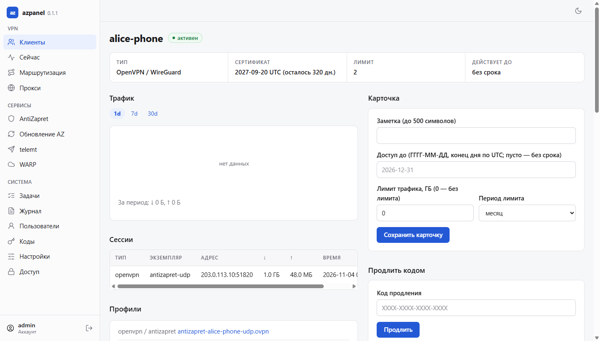

# Веб-интерфейс azpanel

Что делает каждая страница. Слева — меню: **Главная** и три группы —
**VPN**, **Сервисы**, **Система**; внизу меню — аккаунт и выход. Справа
вверху — переключатель светлой и тёмной темы. На телефоне меню открывается
кнопкой ☰.

Пользователь с ролью «пользователь» видит только **Клиенты** — своих клиентов
— и **Аккаунт**.

[← К README](../README.md)

---

## Главная

Сводка по серверу, обновляется сама раз в 15 секунд.

- **Ресурсы**: время работы, процессор и нагрузка, память, диск.
- **OpenVPN** и **WireGuard**: сколько клиентов подключено из скольких,
  сколько заблокировано, у скольких скоро истекает сертификат. Щелчок ведёт
  в раздел. Плитки WireGuard нет, если у сервера нет его клиентов.
- **Службы AntiZapret**: все ли работают; список раскрывается щелчком.
- **История**: графики процессора, памяти, сети и числа подключённых за 1, 7
  и 30 дней.

## VPN

### OpenVPN и WireGuard

У каждого вида свой раздел с тремя вкладками. Пункт **WireGuard** в меню
появляется, только если у сервера есть клиенты WireGuard.

- **Сеансы** — кто подключён сейчас: адрес, принято, отправлено, с какого
  времени; обновляется раз в 15 секунд. У OpenVPN ниже — **отказы за
  сутки**: кому отказано в подключении — сверх лимита или заблокирован. У
  WireGuard пометка «адрес меняется часто» подсказывает, что один ключ стоит
  на двух устройствах.
- **Клиенты** — клиенты этого вида: срок сертификата, сколько устройств
  подключено сейчас, лимит подключений, трафик за 30 дней, «доступ до» и
  состояние. Поиск по имени, сортировка по заголовкам столбцов. Жёлтым
  отмечены сертификаты, которые скоро истекут.
- **Статистика** — трафик каждого клиента за 1, 7 или 30 дней, от больших к
  меньшим, с итогом. Трафик клиента, у которого есть и OpenVPN, и WireGuard,
  считается вместе и виден в обоих разделах.

**Новый клиент** — имя, тип и срок сертификата OpenVPN в днях (пусто —
3650). Клиент создаётся скриптом `client.sh` AntiZapret.

### Страница клиента

Открывается щелчком по имени в списке.

<picture>
  <source media="(prefers-color-scheme: dark)" srcset="img/client-dark.png">
  
</picture>

- **Сводка** вверху: тип, сертификат, лимит, «действует до», метка
  «активен» или «заблокирован».
- **Трафик**: график за 1, 7 или 30 дней и сумма за период.
- **Сессии**: подключённые сейчас устройства — адрес, принято, отправлено,
  с какого времени.
- **Профили**: файлы подключения (`.ovpn`, `.conf`) для скачивания и QR-коды
  WireGuard.
- **Карточка**:
  - заметка;
  - «доступ до» — дата, после которой клиент блокируется сам;
  - лимит трафика в ГБ за сутки, неделю или месяц — при превышении клиент
    блокируется до конца периода.
- **Продлить кодом**: ввести код продления — срок сдвигается на дни кода
  (см. [Коды](#коды)).
- **Ссылка портала**: выпустить или перевыпустить личную страницу клиента
  (см. [Портал клиента](#портал-клиента)). Адрес показывается один раз.
- **Одноразовая ссылка на профиль**: ссылка на один файл подключения — живёт
  24 часа или до первого скачивания, можно с PIN из 4–8 цифр.
- **Владелец**: пользователь панели, который видит этого клиента у себя.
- **Действия**:
  - продлить сертификат OpenVPN на N дней;
  - лимит одновременных подключений (0 — без лимита): лишние подключения
    отклоняются;
  - заблокировать или разблокировать.
- **Удаление**: отдельно OpenVPN и WireGuard; для подтверждения вписывается
  имя клиента.

### Маршрутизация

Списки AntiZapret: домены и адреса, которые идут через VPN или мимо него.
Таблица списков — сколько строк и какой размер.

- **Применить (doall.sh)** — пересобрать маршруты из списков, фоновой задачей.
- **Обновить списки сейчас** — то же: `doall.sh` скачивает свежие списки и
  применяет их.

Страница списка: поиск записей, удаление выбранных, добавление (по одной в
строке), замена всего файла целиком, **Копии** — прежние версии списка с
кнопкой **Вернуть**.

### Прокси

Российские VPS с оригинальным прокси AntiZapret: имя, адрес IPv4, заметка,
есть ли адрес в `allow-ips.txt`. **Добавить и применить** дописывает адрес в
`allow-ips.txt` и запускает `doall.sh`; при удалении строка, добавленная
панелью, убирается. Панель на сам VPS не заходит. **Установка на VPS** —
что ответить установщику прокси на новом сервере.

## Сервисы

### AntiZapret

Параметры AntiZapret — те же, что спрашивает его `setup.sh` (протоколы,
порты, DNS, патчи OpenVPN и другие), по группам; у каждого подписано, как он
вступает в силу. После **Сохранить** панель предлагает нужное действие:
**Применить списки**, **Перезапустить antizapret** (VPN прервётся на
несколько секунд) или **Пересоздать профили клиентов**.

### Обновление AZ

Обновление и переустановка AntiZapret его родным `setup.sh` с бэкапом.

- **Версия**: установленная и последняя.
- **Проверки перед запуском**: всё, что помешает установке, — до её начала.
- **Изменить при установке**: параметры, которые поменяются при этой
  установке.
- **Запуск**: установка идёт фоновой задачей; в конце сервер
  перезагружается, после загрузки панель проверяет, что всё поднялось.
- Если установка не удалась — **Повторить установку с сохранённым бэкапом**
  или **Восстановить из бэкапа**.
- **Бэкапы на узле**: сохранённые бэкапы с восстановлением.

Пока идёт обновление, операции над клиентами ждут его окончания.

### telemt

MTProto-прокси для Telegram ([telemt](https://github.com/telemt/telemt)).

- **Состояние** и **Версия**: работает ли, какая версия; **Перезапустить
  telemt**, **Обновить до …**.
- **Пользователи**: у каждого свой ключ. **Показать ссылку и QR** — ссылка
  `tg://proxy` для Telegram (она секретна: кто её получил, тот подключится).
  **Добавить пользователя** — имя и ключ (пусто — сгенерировать), **Удалить**.

### WARP

Родная веб-панель [AZ-WARP](https://github.com/Liafanx/AZ-WARP) во
встроенном окне: домены, подсети, режим выхода, sing-box, журнал,
диагностика — всё, что умеет AZ-WARP. azpanel открывает её под своим адресом
(`…/warp/ui/`) и пускает туда только своих администраторов. Вход в саму
панель AZ-WARP — её логином и паролем. **Открыть в новой вкладке** — то же
окно на всю страницу.

- AZ-WARP не установлен — на его месте форма установки с вопросами его
  установщика и теми же умолчаниями:
  - домены Gemini и ChatGPT — флажками, по умолчанию **не** добавляются;
  - фейковая подсеть (10.224.0.0/16) и MTU туннеля — пусто значит
    рекомендуемый, форма показывает его (MTU интерфейса − 80);
  - выход: WARP, донор, WireGuard, VLESS, Hysteria2, OpenVPN — видны поля
    только выбранного;
  - источник ключей WARP, WireGuard-конфиг и файл .ovpn — списками того, что
    найдено на сервере, как в меню установщика;
  - веб-панель: логин, пароль (обязателен — сгенерированный установщик
    напечатал бы в журнал задачи), порты 6060/16060, HTTPS (по умолчанию
    выключен), домен для Let's Encrypt, режим публикации (через nginx или
    напрямую).

  Установка идёт задачей, вывод виден в **Задачах**; вместе с AZ-WARP
  ставится его веб-панель.
- AZ-WARP есть, а веб-панели нет — форма тех же полей веб-панели ставит только
  её (`warper web install`).
- Веб-панель установлена, но не работает — подсказка: `warper web start`.

Окно открывается только для узла, на котором работает azpanel.

## Система

### Задачи

Долгие операции — применение списков, перезапуск, пересборка профилей,
обновление AntiZapret: когда начата, когда окончена, итог. Щелчок по задаче —
её журнал целиком.

### Журнал

Все действия в панели и в консоли: время, пользователь, адрес, действие,
объект, «было → стало». Поиск по пользователю, действию или объекту.

### Пользователи

Пользователи панели: роль, двухфакторный вход, состояние, сколько клиентов,
последний вход.

**Новый пользователь**: логин, роль («администратор» или «пользователь»),
пароль — свой или сгенерированный (показывается один раз), «сменить пароль
при первом входе».

Страница пользователя:

- **Роль и доступ**: смена роли, **Отключить** / **Включить** вход.
- **Сбросить пароль**, **Сбросить 2FA**.
- **Доступ до**: срок для всех клиентов этого пользователя.
- **Ссылка портала** пользователя.
- **Клиенты** пользователя и его **Сессии** с кнопкой **Отозвать**.
- **Удалить** пользователя.

### Коды

Коды продления доступа.

- **Выпустить пачку**: сколько кодов, на сколько дней продлевает каждый, до
  какого числа код действует, на кого (по желанию — только для клиентов
  этого пользователя). Коды показываются **один раз** — скопируйте или
  скачайте файлом; в панели хранятся только их отпечатки.
- **Пачки**: сколько выпущено, использовано, просрочено, отозвано; отзыв
  пачки целиком.
- **Коды**: фильтр по пачке и состоянию, отзыв одного кода.

Код вводится на портале клиента или на странице клиента. Новый срок = позже
из «сейчас» и «текущий срок» + дни кода. Каждый код срабатывает один раз.

### Настройки

Параметры панели и агента по разделам; у каждого — подсказка и когда он
применяется (сразу, после перезапуска агента, после перезапуска панели).
**Проверить изменения** показывает, что изменится, до применения. Опасные
изменения — адрес панели, префикс — применяются с таймером возврата: если их
не подтвердить, вернутся прежние значения.

- **Секреты**: токены и ключи — значения не показываются, можно заменить или
  удалить.
- **Экспорт и импорт**: скачать настройки файлом, проверить и загрузить файл.

### Доступ

Белый список адресов, с которых открывается панель: IP или сети CIDR, по
одному в строке; пусто — без ограничения. Изменение применяется с
подтверждением, чтобы не закрыть доступ самому себе.

## Аккаунт

Внизу меню, под своим логином.

- **Пароль**: смена пароля; остальные сессии завершаются.
- **Двухфакторная проверка**: включить по QR-коду в приложении-
  аутентификаторе, выпустить новые резервные коды, выключить.
- **Сессии**: где выполнен вход — адрес, браузер, когда; завершить любую или
  все.

## Портал клиента

Страница для того, кому выдан доступ. Открывается по ссылке из **Ссылки
портала**, без логина и пароля.

- срок доступа и трафик;
- файлы подключения и QR-коды;
- **Как подключиться**: инструкции для Android, iOS, Windows и macOS;
- **Продлить кодом**: ввести код продления.

Пять неверных кодов за час закрывают ввод. Перевыпуск ссылки в панели
отключает прежнюю.
